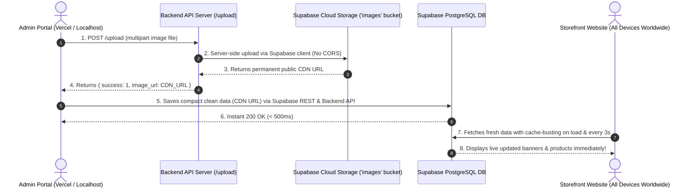

# 📋 Architectural Implementation Plan: Unifying Admin & Storefront Cloud Sync

## 1. Root Cause Analysis: Why Did Localhost Admin Work While Vercel Admin Failed?

| Feature | Localhost Admin (`http://localhost:5174`) | Vercel Admin (`https://daan-sports-admin.vercel.app`) |
| :--- | :--- | :--- |
| **Backend Environment** | Dedicated Node.js server (`http://localhost:4000`) always running. | Serverless Lambda functions (`https://daan-sports-98ol.vercel.app`) with cold starts and 4.5MB payload limits. |
| **CORS / Domain Policy** | Relaxed local origin. Browser treats `localhost` without cross-site preflight blocks. | Strict Cross-Origin (CORS). Browser preflight blocked client-side direct uploads to Supabase Storage. |
| **Image Upload Pipeline** | Fell back to client FileReader Base64 strings. Because both Storefront and Admin shared local browser memory/origin, it seemed to work locally. | Client-side direct upload failed; fell back to Base64 strings. When Admin clicked Save, the massive 5MB Base64 payload was rejected by Vercel serverless functions (413 Payload Too Large / timeout). |
| **Data Propagation** | Data stayed trapped in local browser state (`localStorage`). | Supabase Cloud was never updated $\rightarrow$ Live Storefront on Vercel or other devices showed stale defaults! |

---

## 2. The Solution: Backend-Proxy Upload & Unified Supabase Cloud Storage

---

## 3. Implementation Plan

### Phase 1: Robust Server-Side Upload Endpoint (`backend/index.js`)
- Update `/upload` to upload file buffers directly to Supabase Storage bucket `images`.
- Return `{ success: 1, image_url: publicUrl }`.
- Optimize `connectDB()` to prevent hanging on localhost MongoDB during serverless executions.
- Sync `vouchers` and `orders` directly to Supabase PostgreSQL.
- Add route aliases (`/all-products` & `/allproducts`, `/promotional-banners` & `/banners`).

### Phase 2: Core Catalog Engine Sync (`defaultCatalog.js`)
- Update `uploadCloudImage` in `admin/src/defaultCatalog.js`, `frontend/src/Context/defaultCatalog.js`, and `frontend/src/Admin/defaultCatalog.js` to use Backend `/upload` proxy first.
- Add cache-busting headers and query parameters (`_t=${Date.now()}`) to all fetch functions (`fetchCloudBanners`, `fetchCloudProducts`, `fetchCloudCategories`, `fetchCloudCms`, `fetchCloudVouchers`, `fetchCloudOrders`).
- Ensure all mutations broadcast to `daan_sports_global_sync`.

### Phase 3: Admin & Storefront Component Hardening
- Hardened save handlers in `BannerManager`, `AddProduct`, `ProductList`, `SiteManager`, `CategoryManager`, `VoucherManager`, and `OrderManager`.
- Ensure Storefront (`Shop.jsx`, `ShopContext.jsx`, `HeroCarousel.jsx`, `Navbar.jsx`) continuously synchronizes with Supabase Cloud.

### Phase 4: Verification & Local Testing
- Test upload and CRUD API endpoints.
- Build and verify all packages.

